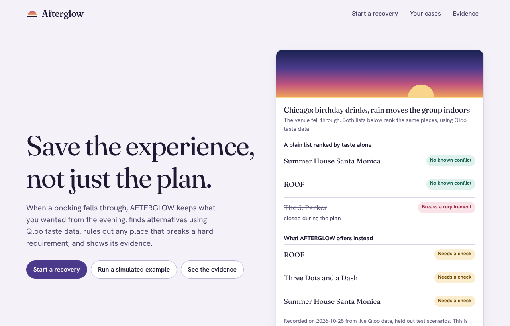
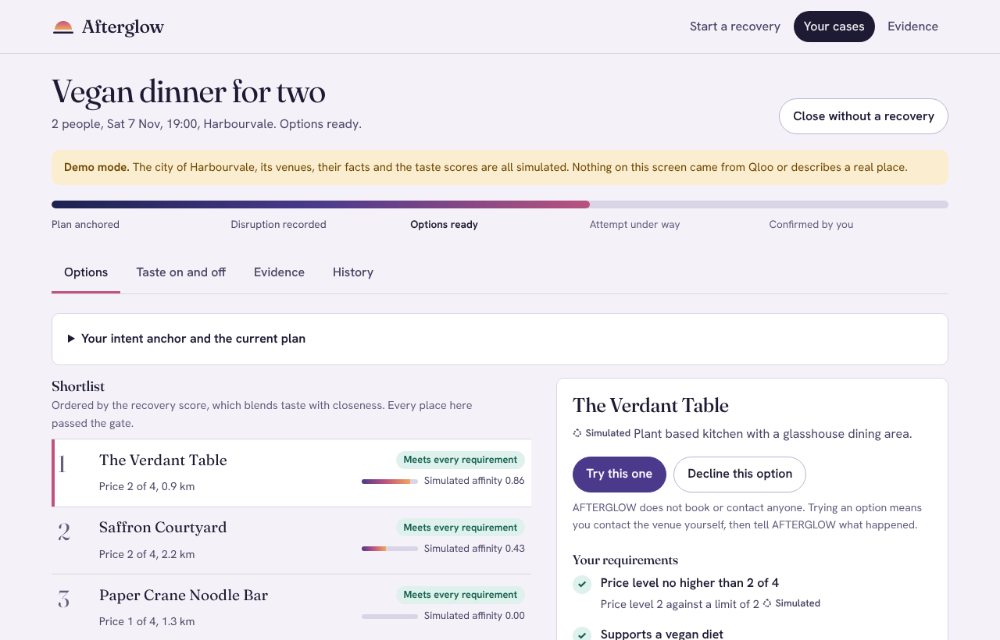
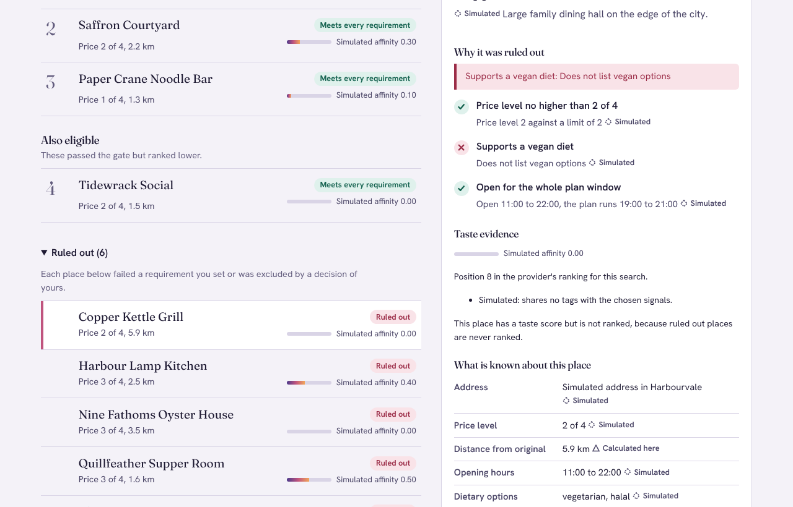
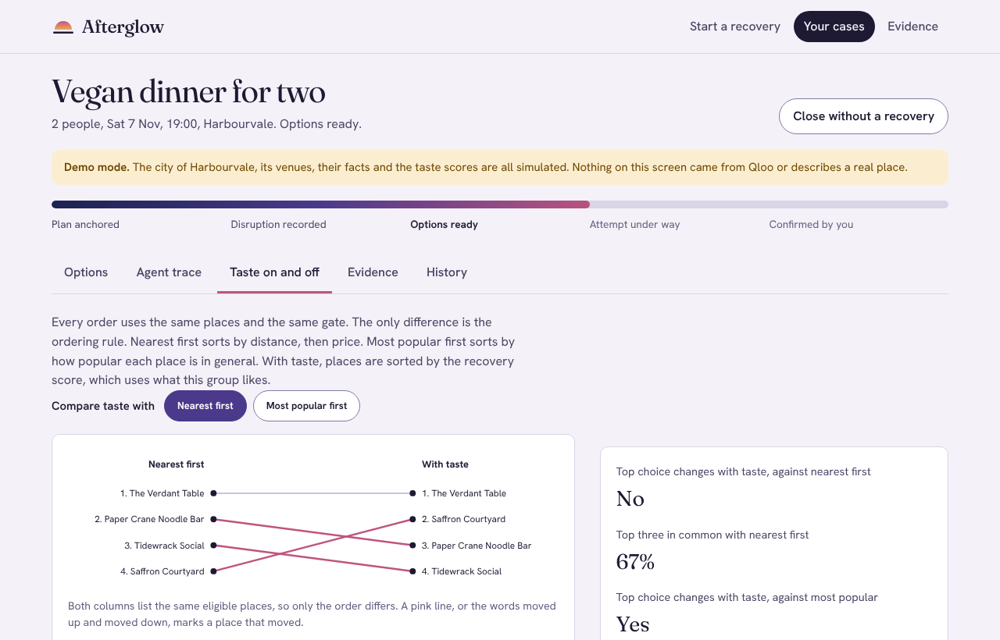

# AFTERGLOW

**Save the experience, not just the plan.**

AFTERGLOW is a culturally intelligent experience recovery agent. When a booking falls through, a venue closes or the weather turns, it keeps what the plan was for, uses Qloo taste data to find alternatives, rules out any place that breaks a hard requirement, and shows the evidence behind every suggestion. It never books anything. A recovery is confirmed only when the person says so.

Built by Team Kanban (Huda Mueen Qureshi, Awaiz Ahmed) for the Qloo Agentic Hackathon.

## Verification status

This table states what has and has not been verified. It is updated whenever the facts change.

| Item                                          | Status                                                                                                     |
| --------------------------------------------- | ---------------------------------------------------------------------------------------------------------- |
| Unit and integration tests                    | Passing (`npm test`)                                                                                       |
| Browser tests with accessibility checks       | Passing (`npm run test:e2e`)                                                                               |
| Type check, lint, formatting                  | Passing (`npm run check`)                                                                                  |
| Continuous integration                        | Passing on GitHub Actions for commit 67c916b: checks, build and browser tests (`.github/workflows/ci.yml`) |
| Offline evaluation on the simulated catalogue | Run, results in [docs/EVALUATION_RESULTS.md](docs/EVALUATION_RESULTS.md)                                   |
| Live Qloo smoke test (`npm run qloo:smoke`)   | **Not yet run.** It needs a personal Qloo key, which the team runs locally and never commits               |
| Live Qloo evaluation                          | **Not yet run.** It depends on the smoke test                                                              |
| Hosted demo                                   | **Not yet deployed**                                                                                       |

Until the live rows change, nothing in this repository claims that AFTERGLOW has been verified against the real Qloo API. Demo mode uses an invented catalogue and says so on every screen.

## Screenshots

All screenshots come from demo mode. The city, the venues and the taste scores are simulated, and every screen says so. None contains a credential or personal data.

| Landing                                                                                          | Recovery                                                                                          |
| ------------------------------------------------------------------------------------------------ | ------------------------------------------------------------------------------------------------- |
|  |                    |
| **A place ruled out, with the reason**                                                           | **Taste On against Taste Off**                                                                    |
|      |  |

## The problem

A plan that falls apart usually ends with a scramble: a list of nearby places ranked by popularity, none of which feel like the evening that was planned, and some of which cannot work at all because they are too far, too expensive, closed, or unable to seat the group. Recommendation lists optimise for taste or popularity and treat practical needs as an afterthought.

## How AFTERGLOW works

1. **Intent Anchor.** The person describes the plan once: the occasion, the party, the time, what must survive, what the group likes, and the hard requirements. This is recorded as a fixed anchor and is never edited. Later disruptions and decisions are layered on top.
2. **Qloo Taste Engine.** Names and vibes the group likes are matched to Qloo entities and tags. An exact match resolves. Anything else is shown to the person to choose from, and an uncertain match is never passed on.
3. **Feasibility Gate.** Every candidate is checked against every hard requirement and receives a verdict for each one: pass, fail or unknown. A failure rules the place out. An unknown never passes. It becomes a question for the person. The gate is identical whether or not taste is used.
4. **Recovery Orchestrator.** Disruptions, the person's own checks, declined options and relaxations are recorded as events on the case. When no place meets every requirement, AFTERGLOW offers the smallest sets of requirements the person could give up and waits for agreement.
5. **Persistent case history.** Each case is an append only event log in SQLite. The history tab shows every step in plain language.

Each fact in the interface carries a source tag: Qloo, Simulated, You said, You checked, or Calculated here.

## Where Qloo is used

- `/search` resolves names the group likes, and the venue that fell through, which is used as a taste signal so the search looks for places that share its audience. The person can turn this off.
- `/v2/tags` with semantic search resolves vibes and genres, and the venue category tag.
- `/v2/insights` returns the candidate places for a city, and ranks a fixed list of places by affinity to the group's signals and to the lost venue, with explainability when it is available.

Qloo results describe what groups of people tend to like. AFTERGLOW presents them that way and does not treat an affinity as a prediction about any person. The full workflow, parameters and data handling are in [docs/QLOO_INTEGRATION.md](docs/QLOO_INTEGRATION.md).

## Use it from an MCP client

The same workflow is available as MCP tools over stdio, so a model can open a case, ask the person the questions the gate raises, and record their answers. The rules are enforced by the application: unknown never passes, only the person's own word settles a fact, and nothing is booked. See [docs/MCP.md](docs/MCP.md).

## Taste On and Taste Off

For every case the interface can show three orderings of the same eligible places. Nearest first sorts by distance to the original venue, then price. Most popular first sorts by the provider's general popularity and uses none of the group's signals, which is what a plain list of well known places does. Taste On sorts by a recovery score that blends taste with closeness. The pool, the gate and the exclusions are identical in all three, so the only difference is the ordering rule. See [docs/EVALUATION.md](docs/EVALUATION.md) for the method and what it can and cannot show.

## Quick start

Requirements: Node.js 22.13 or newer. No other service is needed.

```sh
git clone https://github.com/hudasol/afterglow.git
cd afterglow
npm ci
npm run build
npm start
```

Open http://127.0.0.1:8788. With no Qloo key the application runs in demo mode only, using the labelled simulated catalogue.

For development with hot reload run `npm run dev`, then open http://127.0.0.1:5173.

### Using live Qloo

1. Request a hackathon key through the form on the Qloo hackathon page. Keys are personal. Never commit or share one.
2. Copy `.env.example` to `.env` and set `QLOO_API_KEY`. The file is ignored by Git.
3. Run `npm run qloo:smoke`. It checks that the key works, that entity and tag matching behave, and that rankings respond to different signals. It prints a verdict and writes a redacted report to `data/evaluation`.
4. Restart the server. The Live Qloo option becomes available on the intake screen.

The key is read only by the server. It is never sent to the browser, logged, or written to a report.

## Configuration

| Variable                          | Default                          | Purpose                                                                   |
| --------------------------------- | -------------------------------- | ------------------------------------------------------------------------- |
| `PORT`                            | `8788`                           | Port to listen on                                                         |
| `HOST`                            | `127.0.0.1`                      | Address to bind. A non loopback address needs a token or public demo mode |
| `DATABASE_PATH`                   | `var/afterglow.db`               | SQLite file for cases                                                     |
| `QLOO_API_KEY`                    | empty                            | Personal Qloo key. Leave empty for demo mode only                         |
| `QLOO_API_URL`                    | `https://hackathon.api.qloo.com` | Qloo API host                                                             |
| `QLOO_TIMEOUT_MS`                 | `15000`                          | Per request timeout                                                       |
| `QLOO_DAILY_CALL_CAP`             | `2000`                           | Protective cap on Qloo calls per UTC day. `0` turns it off                |
| `AFTERGLOW_PUBLIC_DEMO`           | `false`                          | Allow a non loopback bind without a token, for the hosted demo            |
| `AFTERGLOW_ACCESS_TOKEN`          | empty                            | Optional bearer token that protects `/api` (16 or more characters)        |
| `AFTERGLOW_ALLOWED_ORIGINS`       | empty                            | Extra browser origins allowed to make write requests                      |
| `AFTERGLOW_RATE_LIMIT_PER_MINUTE` | `120`                            | Requests per minute per client. `0` turns it off                          |
| `AFTERGLOW_TRUST_PROXY`           | `false`                          | Trust the first proxy for client addresses                                |
| `AFTERGLOW_CASE_TTL_HOURS`        | `48`                             | How long idle cases are kept                                              |
| `SERVE_WEB`                       | `true`                           | Serve the built interface from the API server                             |

## Commands

| Command              | What it does                                          |
| -------------------- | ----------------------------------------------------- |
| `npm run dev`        | API server and web dev server with reload             |
| `npm run build`      | Build the interface to `web/dist`                     |
| `npm start`          | Run the server                                        |
| `npm test`           | Unit and integration tests                            |
| `npm run test:e2e`   | Browser tests, including accessibility checks         |
| `npm run check`      | Type check, lint, formatting check and tests          |
| `npm run mcp`        | MCP server over stdio. See [docs/MCP.md](docs/MCP.md) |
| `npm run eval`       | Offline evaluation on the simulated catalogue         |
| `npm run qloo:smoke` | Live Qloo experiment. Needs `QLOO_API_KEY`            |

Browser tests download nothing at run time but need a Playwright Chromium. If your Chromium is installed elsewhere, set `PLAYWRIGHT_CHROMIUM_PATH` to its executable.

## Project layout

```
src/domain          Pure rules: intent, gate, scoring, case events and views
src/application     Use cases and the taste provider port
src/infrastructure  Configuration, SQLite and repositories
src/qloo            Qloo client, matching, normalisation and the live provider
src/simulation      The labelled simulated catalogue, provider and scenarios
src/evaluation      Independent oracle, evaluation runner and report writer
src/interfaces/http The Express API and static serving
src/interfaces/mcp  The MCP server and its compact case summary
web                 React interface
e2e                 Browser tests
docs                Integration, architecture, evaluation, deployment and limits
```

The domain layer imports nothing from the outer layers and performs no input or output. A lint rule enforces this.

## Known limitations

The full list is in [docs/LIMITATIONS.md](docs/LIMITATIONS.md). The most important points:

- The live Qloo path has not yet been verified with a real key.
- In live mode Qloo does not supply opening hours, dietary options, accessibility, capacity or covered seating in a form AFTERGLOW reads, so those requirements stay unknown until the person checks them. The gate treats unknown as not passing.
- The offline evaluation uses an invented, hand authored catalogue. It shows how the pipeline behaves. It is not evidence about the quality of Qloo recommendations.
- AFTERGLOW does not book, call or message anyone. Confirmed means the person said so.
- Cases are tied to a browser through a random identifier. There are no accounts.

## Responsible use

See [docs/RESPONSIBLE_USE.md](docs/RESPONSIBLE_USE.md). In short: only the city, the venue category, public taste names and phrases, and the original venue name, when it is used as a taste signal or a distance limit needs it, are sent to Qloo. Titles, party sizes, notes and times stay on the server. Qloo affinities are never presented as predictions about an individual.

## Submission

The hackathon submission text, covering the six requested items, is in [docs/SUBMISSION.md](docs/SUBMISSION.md).

## License

MIT. See [LICENSE](LICENSE).
